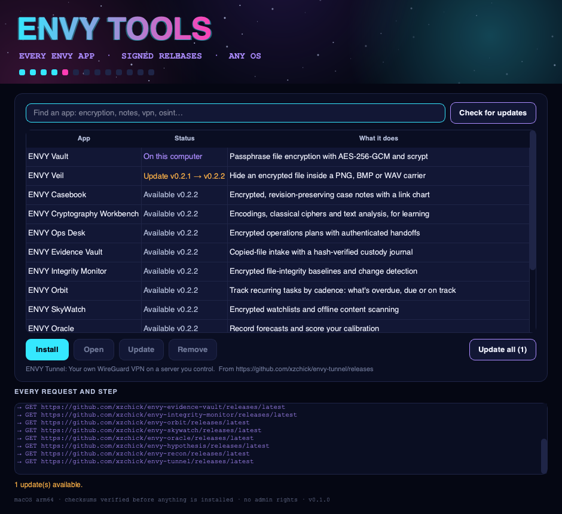

<p align="center"><b>ENVY TOOLS</b><br />Every ENVY app in one place: find it, install it, keep it updated. On any OS.</p>

<p align="center">
  <a href="https://github.com/xzchick/envy-tools/actions/workflows/tests.yml"></a>
</p>
<p align="center">
  
  
  <br />
  
  
  
  
</p>
<p align="center">
  <a href="https://github.com/xzchick/envy-tools/releases/latest"></a>
  <a href="#verifying-a-release"></a>
  <a href="https://github.com/xzchick/envy-tools/releases/latest"></a>
  <a href="#install-on-linux"></a>
  <a href="https://xzchick.github.io/homebrew-envy/"></a>
</p>

ENVY Tools is the one app you need to get every other ENVY app. It lists the whole suite,
installs the standalone build made for your computer (no Python needed), checks it against
the release's checksums before anything is unpacked, adds it to your Start Menu, Applications
folder or app menu, and tells you when updates are out.

<p align="center"></p>

## What it does

- **Find:** all 13 ENVY apps with a one-line description each, searchable ("encryption",
  "vpn", "notes"…). New apps appear automatically: the list is read from this repository, with
  a built-in copy for when you're offline.
- **Install:** downloads the app's latest release bundle for your OS and CPU, verifies its
  SHA-256 against the release's `SHA256SUMS.txt`, unpacks it safely, and adds a launcher:

  | OS | Apps go to | Launcher |
  |---|---|---|
  | **macOS** | `~/Library/Application Support/ENVY Tools` | an app in `~/Applications` (Launchpad, Spotlight) and a command in `~/.local/bin` |
  | **Windows** | `%LOCALAPPDATA%\ENVY Tools` | a Start Menu shortcut under **ENVY** |
  | **Linux** | `~/.local/share/envy-tools` | an app-menu entry and a command in `~/.local/bin` |

- **Update:** one click per app, or *Update all*. The old version is removed after the new
  one is in place, so a failed update never leaves you without the app.
- **Open and remove:** start an app from the list. Removing deletes exactly what ENVY Tools
  installed: your own files made with the app are never touched.
- **Notice what you already have:** apps installed some other way (Homebrew, `install.sh`)
  show as *On this computer*.

No administrator rights are used, and nothing outside your own user folders is touched.

## Using it

The window does everything. The same is available from a terminal:

```sh
envy-tools list                     # every app, and which are installed
envy-tools list --check             # …plus the latest version of each
envy-tools list vpn                 # search
envy-tools install vault veil       # or: install all
envy-tools update                   # update everything installed
envy-tools open vault
envy-tools remove oracle
envy-tools where                    # where apps and launchers go on this computer
```

`--offline` uses the built-in app list and makes no network requests.

## Install

**macOS (Homebrew, Apple Silicon)**

```sh
brew tap xzchick/envy https://github.com/xzchick/homebrew-envy
brew install --cask envy-tools
```

**Windows**: download `envy-tools-vX.Y.Z-windows-x86_64.zip` from the
[latest release](https://github.com/xzchick/envy-tools/releases/latest), unzip, and run
`envy-tools.exe`.

## Install on Linux

One command (downloads the latest release bundle, verifies it against the signed
`SHA256SUMS`, and installs under `~/.local` with a desktop entry, no root needed):

```sh
curl -fsSL https://raw.githubusercontent.com/xzchick/envy-tools/main/install.sh | sh
```

Prefer to inspect first? Download `install.sh`, read it, then run `sh install.sh`.

**From source** (any OS, Python 3.10+): `pip install .` then `envy-tools`.

## How installs are verified

1. The latest version comes from GitHub's `/releases/latest` redirect for that app's repository.
2. ENVY Tools downloads that release's `SHA256SUMS.txt`. If [`cosign`](https://docs.sigstore.dev)
   is installed, it also verifies the **Sigstore signature** on that file. That proves it was made
   by the app's own release workflow on GitHub. Add `--require-signature` to refuse any install
   without that check.
3. It downloads the bundle and compares its SHA-256. On a mismatch nothing is unpacked or installed.
4. Unpacking refuses absolute paths, `..`, and links that point outside the app's folder.

Requests go only to GitHub (`github.com`, `raw.githubusercontent.com` and GitHub's download
hosts) over HTTPS, even after redirects. Every request is shown in the window's log, or on the
terminal. There's no telemetry and no account.

Without `cosign`, the checksum file comes from the same GitHub release as the bundle. That
protects against corrupted and swapped downloads, but it relies on GitHub and HTTPS for the
file itself. Install `cosign` (or use `--require-signature`) for the stronger guarantee.

**Limits:** macOS builds are Apple Silicon only for now, and Linux builds are x86_64 only.
Windows on Arm uses the x86_64 build.

## Verifying a release

Every release's `SHA256SUMS.txt` is signed with Sigstore (keyless) and ships with a CycloneDX SBOM:

```sh
cosign verify-blob \
  --bundle SHA256SUMS.txt.sigstore.json \
  --certificate-identity-regexp 'https://github.com/xzchick/envy-tools/.github/workflows/release.yml@.*' \
  --certificate-oidc-issuer https://token.actions.githubusercontent.com \
  SHA256SUMS.txt
sha256sum --check --ignore-missing SHA256SUMS.txt
```

## Tested for real

Unit tests run on macOS, Windows and Linux against a fake GitHub serving real bundles. They
cover tampered checksums, path-traversal archives and the per-OS launchers. Then each OS's
**built** ENVY Tools does a real install of ENVY Veil from GitHub. It runs the installed app,
then removes it and checks nothing is left (`scripts/smoke_test_release.py`).

MIT licensed. Part of [ENVY BLACK VEIL](https://xzchick.github.io/homebrew-envy/).
